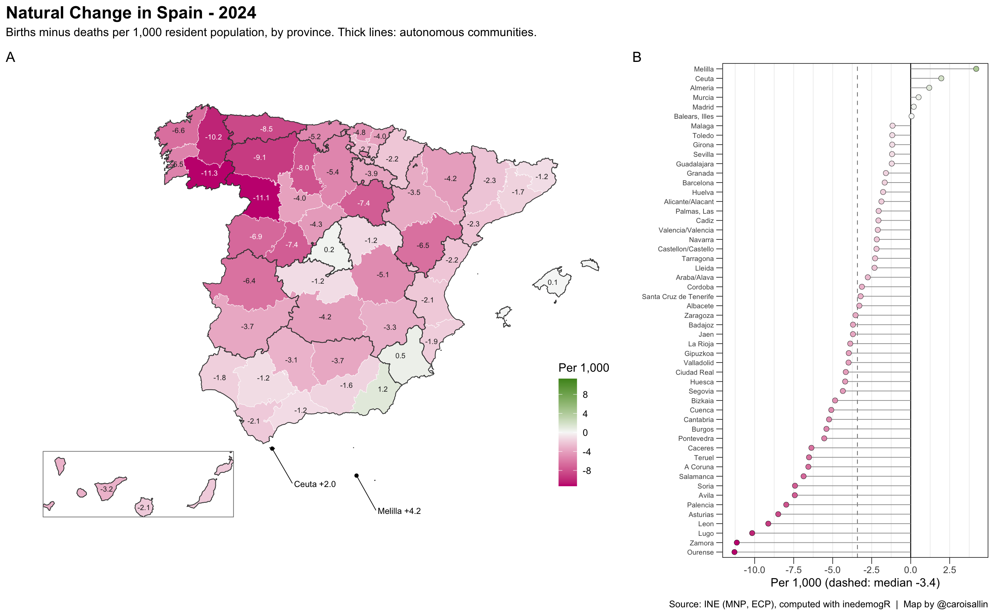
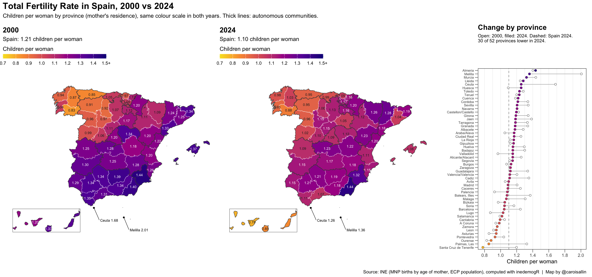
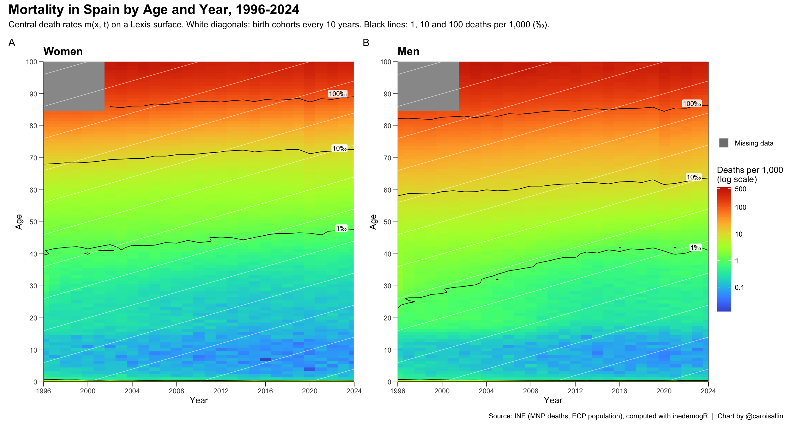
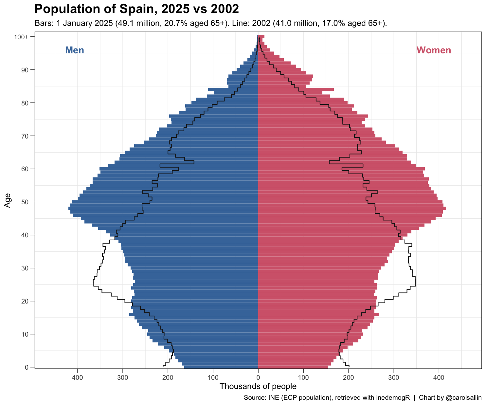
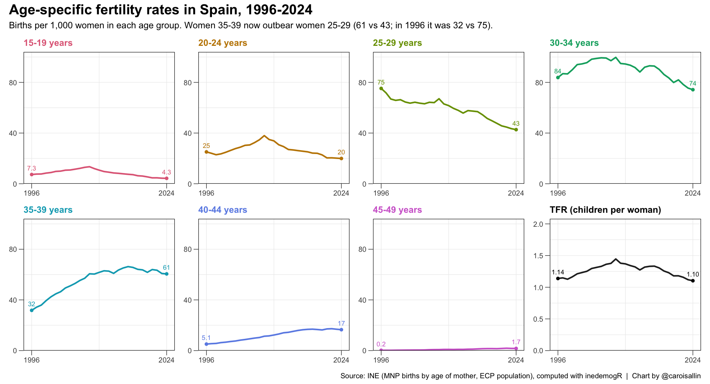

```{r setup, include=FALSE}
knitr::opts_chunk$set(echo = FALSE, out.width = "100%")
```

Figures built end to end with `inedemogR` from live INE data: every number
below comes from the package's retrieval and indicator functions. Styling is
added on top with `ggplot2`, `sf` and `patchwork`. The
[Gallery code](gallery-code.html) article walks through the `inedemogR` part
of each figure.

## Natural change by province, 2024

Births minus deaths per 1,000 residents.
Functions: `get_ine_births()`, `get_ine_deaths()`, `get_ine_population()`,
`crude_birth_rate()`, `crude_death_rate()`, `rate_of_natural_increase()`,
`get_ine_geo()`.

```{r natural-change}

```

## Total fertility rate by province, 2000 vs 2024

Children per woman by mother's province of residence, on one colour scale for
both years. Spain fell from 1.21 to 1.10, while several north-western
provinces, the lowest in 2000, rose.
Functions: `get_ine_births_by_age()`, `get_ine_population()`,
`age_specific_fertility_rate()`, `total_fertility_rate()`, `get_ine_geo()`.

```{r tfr}

```

## Lexis surface of mortality, 1996-2024

Central death rates by age and year for women and men, with birth-cohort
diagonals and iso-mortality contours. Grey: ages 85+ before 2002, when INE
published population only as an open 85+ group.
Functions: `get_ine_deaths()`, `get_ine_population()`, `compute_exposure()`,
`compute_death_rates()`, `plot_lexis_diagram()`.

```{r lexis}

```

## Population pyramid, 2025 vs 2002

Population on 1 January 2025 by single year of age and sex, with 2002 drawn on
top as an outline. The 1940s post-war cohorts and the baby boom of the 1960s
and 1970s have moved up 23 years; the cohorts born since 2008 are smaller.
Functions: `get_ine_population()`, `plot_population_pyramid()`.

```{r pyramid}

```

## Age-specific fertility rates, 1996-2024

Births per 1,000 women in each five-year age group, with the total fertility
rate in the last panel. Rates below age 30 fell, rates above 35 rose: women
aged 35-39 now have more children than women aged 25-29.
Functions: `get_ine_births_by_age()`, `get_ine_population()`,
`age_specific_fertility_rate()`, `total_fertility_rate()`.

```{r asfr}

```
